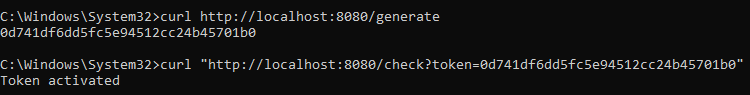
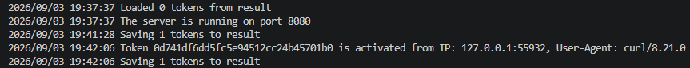
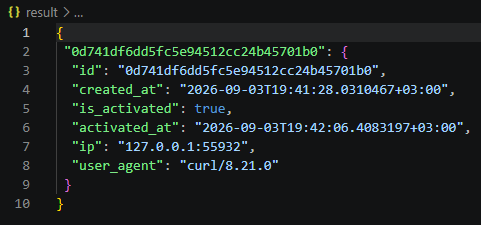

# Canary Token on Go
An HTTP server that generates unique token decoys and logs attempts to access the tokens (time, IP address)
# Launch (example)
go run main.go -port 8080 -json result.json
# Execution result
  
# Flags
-port: Server port, Default value - 8080 |
-json: The name of the JSON file for saving and loading tokens, Default value - (empty)
# Technologies
Go 1.26.5
The Standart Library ("crypto/rand"
	"encoding/hex"
	"encoding/json"
	"flag"
	"fmt"
	"log"
	"net/http"
	"os"
	"os/signal"
	"strings"
	"sync"
	"syscall"
	"time"
)
# Author
Ivan Praporov
https://github.com/Ivandzi
[Telegram](https://t.me/Waltuh_99)
